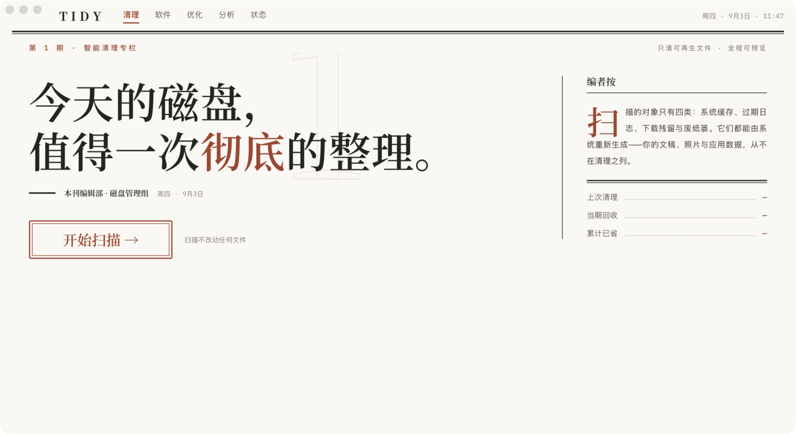

# Tidy

[English](README.md) | 简体中文

**开源的 macOS 清理工具：先让你看清楚，再决定删什么。** Tidy 扫描缓存、日志、
应用残留和旧安装包，列出每一项和它的大小，只把你选中的移到废纸篓。它是 Mole CLI
的桌面版，用 Tauri 2、Rust 和 TypeScript 构建。

[官网](https://tidy.talkwork.vip/zh/) · [下载最新 DMG](https://github.com/OpenFabrica/tidy/releases/latest/download/Tidy.dmg) · [历史版本](https://github.com/OpenFabrica/tidy/releases) · [提交问题](https://github.com/OpenFabrica/tidy/issues)



## 功能

- **清理**：按来源分组列出可回收空间——应用缓存、日志、开发工具、AI 工具、浏览器、
  设计工具、通讯软件，以及残留的 `dmg` / `pkg` / `xip` 安装包。
- **应用**：彻底卸载，残留按类别逐项列出；更新按来源分组（Homebrew / App Store /
  Sparkle / Electron / 官网）；登录项管理。
- **优化**：一次有边界的维护：启动速度、系统数据库、网络与搜索。不装任何东西，
  不删个人文档。
- **分析**：磁盘或文件夹的树状图；可逐层进入、随时取消、把目录移到废纸篓。
- **状态**：CPU、内存、磁盘、网络、电池、GPU、风扇和进程详情，也可以在菜单栏查看。

## 安全模型

- 所有删除类功能都先生成 `DeletionPlan`，只能经过 `mole-core` 里唯一的删除出口执行。
  预览、确认、执行用的是同一批候选项。
- 用户范围的删除都进废纸篓，可以恢复。
- 系统范围的操作在特权 helper 通道上线前一律以 `requires_admin` 拒绝，不会退回到
  shell 提权。
- 每次运行都写入 `~/Library/Logs/mole`，格式与 `mo history` 兼容。

## 安装

下载 [Tidy.dmg](https://github.com/OpenFabrica/tidy/releases/latest/download/Tidy.dmg)。
Universal 包（Intel 和 Apple 芯片都能用），需要 macOS 11 或更新版本，已用 Developer ID
签名并通过 Apple 公证。应用会自动更新。

## 从源码构建

需要 Rust stable 和 Node 20+。

```bash
git clone https://github.com/OpenFabrica/tidy.git
cd tidy
make desktop-dev      # 构建 helper sidecar、安装 UI 依赖、启动 Tauri dev
make desktop-check    # fmt、Clippy、Rust 测试、TypeScript 检查
make desktop-build    # 构建未签名的应用，不打包
```

## 目录结构

| 路径 | 内容 |
| --- | --- |
| [`desktop/`](desktop/) | Tauri 2 应用：Rust crates（`mole-core`、`mole-macos`、`mole-helper`、`mole-ops`）和 TypeScript 界面。见 [`desktop/README.md`](desktop/README.md)。 |
| [`site/`](site/) | 静态产品站点和博客。见 [`site/README.md`](site/README.md)。 |
| [`tests/fuzz_corpus/`](tests/fuzz_corpus/) | 安全测试必须拒绝的危险路径样本。 |
| [`tools/`](tools/) | 配套服务，例如统计代理。 |

## 参与贡献

先读 [`AGENTS.md`](AGENTS.md) 和 [`desktop/AGENTS.md`](desktop/AGENTS.md)。提交信息
遵循 Conventional Commits。开 PR 前跑一次 `make desktop-check`，改了 IPC、权限、日志
或删除策略要明确写出来。

遇到看不懂的拒绝原因，请提 issue，附上拒绝码（`probe_failed`、`requires_admin` 等）
和 `~/Library/Logs/mole` 里对应的几行。
